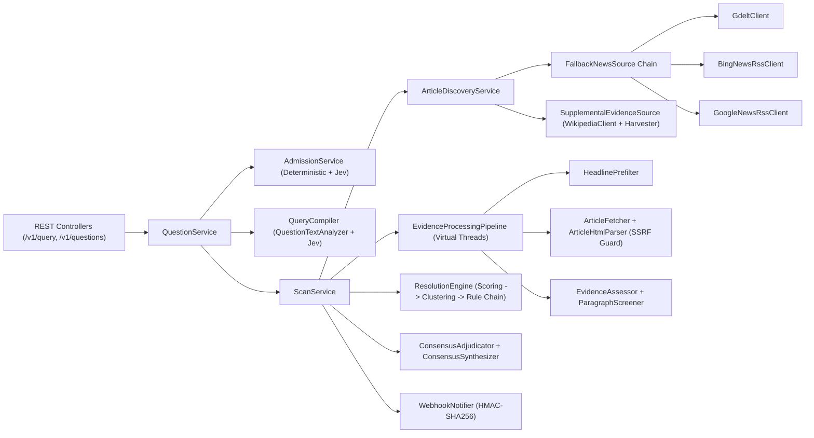

# AlithesOracle

News-verified event oracle built on **Spring Boot 3.5 / Java 21**, **PostgreSQL 16 + Flyway**, and **TypeSafe AI Jev** (`jev-1.14.0`). Given a discrete factual event question, AlithesOracle admits well-scoped questions, compiles sanitized search queries, discovers articles across GDELT, Bing/Google News RSS fallbacks, and targeted Wikipedia footnotes, evaluates full article text against prompt injection and stance instability, and settles questions deterministically with optional consensus synthesis and HMAC-SHA256 webhooks.

---

## Architecture



---

## Package & Module Structure

- `io.alithes.oracle.config`: Strongly typed, validated `@ConfigurationProperties` records (`OracleProperties`, `HttpClientProperties`, `JevProperties`, `GdeltProperties`, `FetcherProperties`, `ScannerProperties`, `NewsProperties`, `WebhookProperties`, `PolicyProperties`, `SecurityProperties`, `AdmissionProperties`, `QueryProperties`, `AssessorProperties`, `SynthesisProperties`, `ScoringProperties`).
- `io.alithes.oracle.client` & `.client.jev`:
  - `DecisionEngine` / `JevClient` and immutable request/response types (`QuestionSpec`, `NoulQuestion`, `ChoiceQuestion`, `Answer`, `NoulAnswer`, `ChoiceAnswer`, `SystemOneRequest`, `SystemOneResponse`, `JevResponse`).
  - `NewsSource` implementations (`GdeltClient`, `AbstractRssNewsClient` template method with `BingNewsRssClient` and `GoogleNewsRssClient`), `FallbackNewsSource` with `CooldownGuard`, `ArticleFetcher` + `ArticleHtmlParser`, and `SupplementalEvidenceSource` (`WikipediaClient` + `WikipediaCitationHarvester`).
- `io.alithes.oracle.service`, `.service.assessment`, `.service.resolution`:
  - `AdmissionService`, `QueryCompiler`, `QuestionService`, `SourceTierRegistry`, `ScanScheduler`, `WebhookNotifier`.
  - `ArticleDiscoveryService`, `EvidenceProcessingPipeline`, `ScanService`.
  - `HeadlinePrefilter`, `ParagraphScreener`, `AssessmentPromptFactory`, `EvidenceAssessor`, `ConsensusSynthesizer`, `ConsensusAdjudicator`.
  - `AttributionTier`, `EvidenceScorer`, `EvidenceCluster`, `EvidenceClusterer`, `ResolutionRule` chain (`ContradictionDisputeRule`, `ConfirmingQuorumRule`, `ActiveBeforeDeadlineRule`, `CoverageGapUnresolvableRule`, `PostDeadlinePartialDisputeRule`, `PostDeadlineNoResolutionRule`), and `ResolutionEngine`.
- `io.alithes.oracle.web`, `.web.dto`, `.web.filter`, `.health`:
  - `QueryController`, `QuestionController`, `SystemController`, `ProblemDetailsFactory`, `GlobalExceptionHandler`, `RequestCorrelationFilter` (`X-Request-Id` / SLF4J MDC), and `OracleHealthIndicator` (`/actuator/health`).
- `src/main/resources/static/`: Bundled zero-build management console using native ES modules (`app.js`, `js/api.js`, `js/state.js`, `js/formatters.js`, `js/evidenceView.js`, `js/systemTab.js`, `js/askTab.js`, `js/questionsTab.js`).

---

## Design Patterns Applied

- **Template Method (`AbstractRssNewsClient`)**: Centralizes RSS HTTP execution, Jsoup XML parsing, date-window filtering, and error translation across RSS providers.
- **Chain of Responsibility (`ResolutionRule`, `FallbackNewsSource`)**:
  - Ordered Spring `@Order` policy rules (`ContradictionDisputeRule` → `ConfirmingQuorumRule` → `ActiveBeforeDeadlineRule` → `CoverageGapUnresolvableRule` → `PostDeadlinePartialDisputeRule` → `PostDeadlineNoResolutionRule`) decide resolution cleanly without monolithic conditionals.
  - News search fails over from primary GDELT through `FallbackProvider` entries (`BingNewsRssClient` → `GoogleNewsRssClient`) guarded by `CooldownGuard`.
- **Strategy (`DecisionEngine`, `NewsSource`, `ContentFetcher`, `SupplementalEvidenceSource`, `ResolutionNotifier`)**: Keeps external APIs, article scrapers, and supplemental citation harvesters swappable and offline-testable.
- **Factory (`ProblemDetailsFactory`, `AssessmentPromptFactory`, `ResolutionRules`)**: Eliminates duplicated RFC 7807 response assembly and Jev prompt schemas.

---

## Quick Start

### 1. Docker Compose (PostgreSQL + Oracle)

```bash
cp .env.example .env
# Edit .env and set TYPESAFE_API_KEY
docker compose up -d --build
```

Verify health and open the console:
- Web Console: http://localhost:8080/
- Health Endpoint: `GET http://localhost:8080/actuator/health`
- Runtime Config Summary: `GET http://localhost:8080/v1/system`

### 2. Local Maven & Tests

All tests run 100% offline against H2 PostgreSQL compatibility mode and WireMock stubs:

```bash
mvn -B test
```

---

## REST API Overview

| Method & Path | Description |
| :--- | :--- |
| `POST /v1/query` | Admits, scans, and resolves a natural-language question synchronously. |
| `POST /v1/questions` | Creates and admits a tracked question (returns HTTP `422` ProblemDetail if rejected). |
| `GET /v1/questions` | Lists tracked questions, optionally filtered by `?status=`. |
| `GET /v1/questions/{id}` | Retrieves question metadata and status. |
| `GET /v1/questions/{id}/evidence` | Lists collected articles and Jev stance assessments (`?stage=` optional). |
| `GET /v1/questions/{id}/scans` | Lists upstream discovery scan logs and error summaries. |
| `GET /v1/questions/{id}/resolution` | Returns final outcome, confidence, supporting cluster IDs, and summary. |
| `POST /v1/questions/{id}/rescan` | Runs an immediate scan pass for an active question. |
| `POST /v1/questions/{id}/review` | Manually settles a `DISPUTED` question. |
| `GET /v1/system` | Returns non-sensitive runtime status, question counts, and active policy settings. |

Every HTTP response includes an `X-Request-Id` header correlated into application logs via SLF4J MDC (`[req:...]`).

---

## Configuration Reference (`oracle.*`)

All policy thresholds, HTTP timeouts, concurrency limits, query compilation bounds, HTML extraction heuristics, and Jev synthesis gates are configured in [application.yml](src/main/resources/application.yml) and validated at startup by `*Properties` records:

- `oracle.http.*`: Shared HTTP client connect timeout.
- `oracle.jev.*`: API endpoint, key, pinned model enforcement (`reject-alias`, `forbidden-aliases`), retry/backoff bounds.
- `oracle.gdelt.*`, `oracle.news.*`: GDELT rate limiting, adaptive window splitting, Bing/Google RSS fallbacks, cooldown duration, Wikipedia page & footnote caps, skipped domains.
- `oracle.fetcher.*`, `oracle.security.*`: SSRF validation (`allow-private-network-urls`, `max-url-length`), HTML size cap, redirect limits, excerpt and paragraph cutoffs.
- `oracle.scanner.*`, `oracle.admission.*`, `oracle.query.*`, `oracle.assessor.*`, `oracle.synthesis.*`, `oracle.scoring.*`, `oracle.policy.*`: Complete deterministic and Jev calibration parameters with environment overrides (`TYPESAFE_API_KEY`, `JEV_MODEL`, `ORACLE_SCHEDULER_ENABLED`, `ORACLE_MAX_AMBIGUOUS_SCORE`, `WEBHOOK_SECRET`).

---

## Security Controls

- **SSRF Prevention (`SafeUrlValidator`)**: Blocks private, loopback, link-local, CGNAT, multicast, IPv6 ULA hosts, userinfo URLs, and invalid ports before fetching article HTML or delivering webhooks (even across redirects).
- **Prompt Injection Defense (`PromptInjectionDetector`)**: Flags suspicious instruction-override payloads in headlines/articles and zeroes their weight during deterministic scoring and synthesis.
- **Pinned Model Guard (`JevClient`)**: Rejects unpinned model aliases (`jev-latest`, `jev-preview`) when `oracle.jev.reject-alias=true`.
- **Signed Webhooks (`WebhookNotifier`)**: Signs resolution payloads with HMAC-SHA256 in the configurable signature header (`X-Alithes-Signature`).
