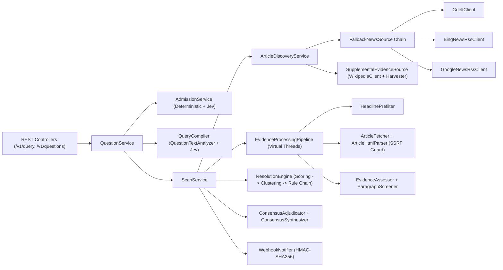

# AlithesOracle

**Automated, auditable real-world event verification powered by independent news coverage.**

AlithesOracle answers discrete yes/no questions about public real-world events—such as elections, regulatory rulings, executive appointments, corporate deals, or policy announcements—and settles them automatically with transparent confidence scores and a full evidence trail.

### Why AlithesOracle?

Organizations that rely on timely, objective real-world outcomes—including **prediction markets, automated compliance and risk teams, parametric triggers, and operational monitoring systems**—often face a painful trade-off between slow manual verification and brittle, single-source automation.

AlithesOracle solves this by combining multi-source news discovery, calibrated AI stance assessment (**TypeSafe AI Jev**), and deterministic consensus rules:

- **Independent Multi-Source Verification:** Aggregates reporting across GDELT, Bing/Google News RSS fallbacks, and targeted Wikipedia citations, then clusters syndicated wire copies so one press release cannot masquerade as multiple independent sources.
- **Transparent Audit Trail:** Every decision is backed by persisted source URLs, excerpts, credibility tiers, per-article assessments, scan logs, and a reproducible confidence score.
- **Manipulation & Noise Resistance:** Screens out ambiguous or non-newsworthy questions up front, downweights rumors and opinion pieces, flags prompt-injection attempts, and routes genuine contradictions to an explicit `DISPUTED` state for review.
- **Ready for Automated Settlement:** Query outcomes on demand via REST, track ongoing events on a schedule, inspect everything in the built-in web console, and receive HMAC-SHA256 signed webhook notifications the moment an event resolves.

---

## Architecture



---

## Quick Start

### 1. Docker Compose (PostgreSQL + Oracle)

```bash
cp .env.example .env
# Edit .env and set TYPESAFE_API_KEY
docker compose up -d --build
```

Verify health and open the console:
- Web Console: http://localhost:8080/
- Health Endpoint: `GET http://localhost:8080/actuator/health`
- Runtime Config Summary: `GET http://localhost:8080/v1/system`

### 2. Local Maven & Tests

All tests run 100% offline against H2 PostgreSQL compatibility mode and WireMock stubs:

```bash
mvn -B test
```

---

## REST API Overview

| Method & Path | Description |
| :--- | :--- |
| `POST /v1/query` | Admits, scans, and resolves a natural-language question synchronously. |
| `POST /v1/questions` | Creates and admits a tracked question (returns HTTP `422` ProblemDetail if rejected). |
| `GET /v1/questions` | Lists tracked questions, optionally filtered by `?status=`. |
| `GET /v1/questions/{id}` | Retrieves question metadata and status. |
| `GET /v1/questions/{id}/evidence` | Lists collected articles and Jev stance assessments (`?stage=` optional). |
| `GET /v1/questions/{id}/scans` | Lists upstream discovery scan logs and error summaries. |
| `GET /v1/questions/{id}/resolution` | Returns final outcome, confidence, supporting cluster IDs, and summary. |
| `POST /v1/questions/{id}/rescan` | Runs an immediate scan pass for an active question. |
| `POST /v1/questions/{id}/review` | Manually settles a `DISPUTED` question. |
| `GET /v1/system` | Returns non-sensitive runtime status, question counts, and active policy settings. |

Every HTTP response includes an `X-Request-Id` header correlated into application logs via SLF4J MDC (`[req:...]`).

---

## Configuration Reference (`oracle.*`)

All policy thresholds, HTTP timeouts, concurrency limits, query compilation bounds, HTML extraction heuristics, and Jev synthesis gates are configured in [application.yml](src/main/resources/application.yml) and validated at startup:

- `oracle.http.*`: Shared HTTP client connect timeout.
- `oracle.jev.*`: API endpoint, key, pinned model enforcement (`reject-alias`, `forbidden-aliases`), retry/backoff bounds.
- `oracle.gdelt.*`, `oracle.news.*`: GDELT rate limiting, adaptive window splitting, Bing/Google RSS fallbacks, cooldown duration, Wikipedia page & footnote caps, skipped domains.
- `oracle.fetcher.*`, `oracle.security.*`: SSRF validation (`allow-private-network-urls`, `max-url-length`), HTML size cap, redirect limits, excerpt and paragraph cutoffs.
- `oracle.scanner.*`, `oracle.admission.*`, `oracle.query.*`, `oracle.assessor.*`, `oracle.synthesis.*`, `oracle.scoring.*`, `oracle.policy.*`: Complete deterministic and Jev calibration parameters with environment overrides (`TYPESAFE_API_KEY`, `JEV_MODEL`, `ORACLE_SCHEDULER_ENABLED`, `ORACLE_MAX_AMBIGUOUS_SCORE`, `WEBHOOK_SECRET`).

---

## Security Controls

- **SSRF Prevention (`SafeUrlValidator`)**: Blocks private, loopback, link-local, CGNAT, multicast, IPv6 ULA hosts, userinfo URLs, and invalid ports before fetching article HTML or delivering webhooks (even across redirects).
- **Prompt Injection Defense (`PromptInjectionDetector`)**: Flags suspicious instruction-override payloads in headlines/articles and zeroes their weight during deterministic scoring and synthesis.
- **Pinned Model Guard (`JevClient`)**: Rejects unpinned model aliases (`jev-latest`, `jev-preview`) when `oracle.jev.reject-alias=true`.
- **Signed Webhooks (`WebhookNotifier`)**: Signs resolution payloads with HMAC-SHA256 in the configurable signature header (`X-Alithes-Signature`).
