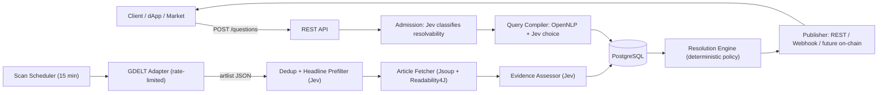
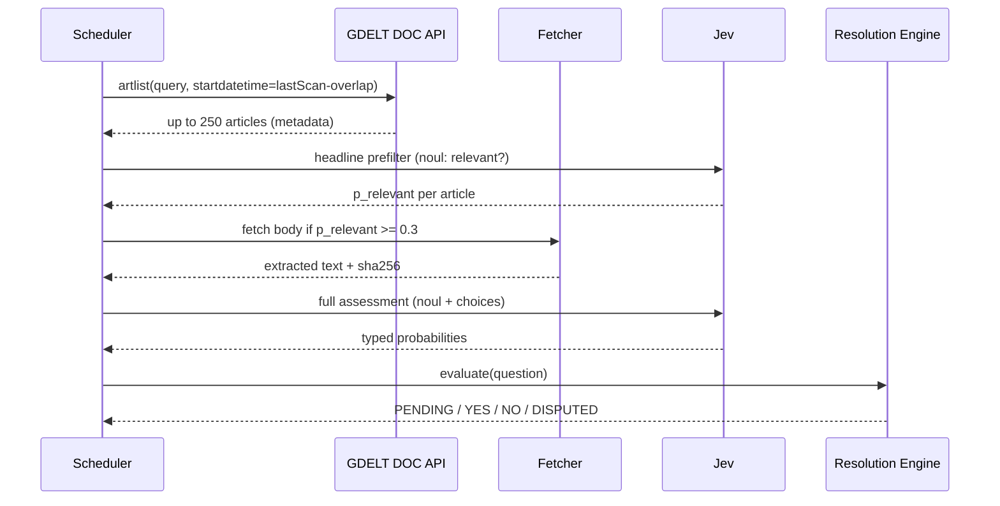
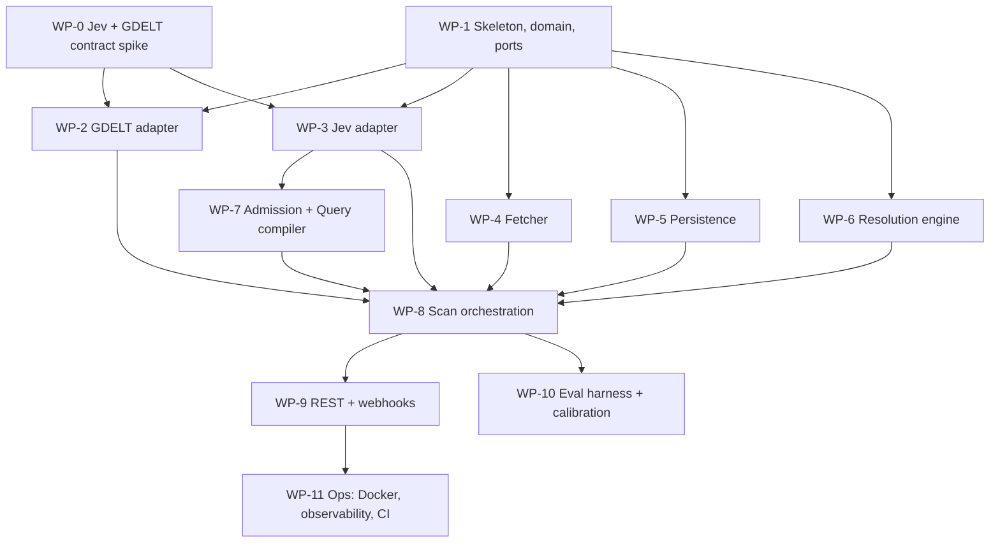

# AlithesOracle: Architecture Overview, Validation and Implementation Plan

> **Audience:** the project owner (sections 1–3) and the engineering agents who will build it (sections 4–10).
> **Assumption:** "JEV" means **Jev by TypeSafe AI**. It is a *decision-only* (non-generative) model. You give it a `state` plus typed questions (`noul` = calibrated yes probability, `choice` = distribution over options you define, `score`), and it returns structured probabilities.

> [!NOTE]
> **Jev contract checked on 2026-11-22** against docs.typesafe.ai and the official OpenAPI spec (`https://api.typesafe.ai/openapi.json`, v0.2.0). The full contract is in `docs/contracts/jev.md`. Key facts:
> - **Endpoint:** `POST https://api.typesafe.ai/v1/systemone` with `Authorization: Bearer <key>`.
> - **Model:** pin `jev-1.14.0`. The aliases `jev-latest` and `jev-preview` move between releases.
> - **Limits:** 64k tokens per request and 32k tokens per question, a 32 MiB maximum body, and rate limits per organization. `429` responses include `retry-after`; `529` means overloaded.
> - **Price:** \$0.042 per million input tokens. Output tokens are free.
> - **SDKs:** official SDKs exist for **Python and JavaScript only**. There is no official Java SDK, so we write our own thin `HttpClient` adapter (this was already the plan).
> - **Known weak spots in Jev**, from TypeSafe's own "model jaggedness" page. Each one changed this design:
>   - **Comparing dates:** Jev can't reliably compare dates or check whether one falls in a window. Code does that now (§5.6).
>   - **Choice option order:** Jev tends to favour the first option, so stance is asked twice with the options in different orders (§5.6).
>   - **Large, irrelevant state:** accuracy drops, so paragraphs are screened before the main assessment (§5.5a).
>   - **Adversarial content:** text written to steer Jev can move its answers. Mitigated by the source quorum (§5.7).
>   - **No "none of these" option:** a Choice always picks something, so each Choice is paired with a "companion Noul" asking whether any option fits.

---

## 1. The idea in one paragraph

A user submits a **natural-language question** such as *"Has Country X officially announced a snap election?"*. The oracle keeps scanning global news through the **GDELT DOC 2.0 API**. For each candidate article it asks **Jev** narrow, typed questions: is the article relevant, does it confirm the event happened, did the event fall inside the question's time window, and how is the claim sourced. Deterministic Java code then combines those per-article judgments across independent sources and settles the question as **YES**, **NO** or **UNRESOLVABLE**, with an evidence trail anyone can audit.

## 2. Validation verdict

**The idea is sound and viable, but the naive version ("GDELT search + ask Jev if it happened") fails. Five design changes are mandatory:**

| # | Naive assumption | Reality | Required correction |
|---|---|---|---|
| 1 | GDELT understands natural-language queries | The GDELT DOC API is **keyword/boolean search** (`"phrase"`, `OR`, `-`, `domain:`, `sourcecountry:`, `theme:`). It rejects very short terms, and `OR` needs parentheses. | Add a **Query Compiler** stage that turns the NL question into a ladder of GDELT queries from strict to broad. |
| 2 | Jev can write the GDELT query | Jev is **non-generative**. It cannot produce strings, only choose and score. | Compile deterministically (NER plus noun-chunk extraction with Apache OpenNLP), generate *candidate* queries, and let **Jev choose and validate** them. This is the "code proposes, Jev decides" pattern. An optional generative-LLM compiler can be added as a plug-in adapter. |
| 3 | GDELT returns the news content | GDELT returns **metadata only** (url, title, seendate, domain, language, sourcecountry). It does not return article bodies. It also only searches a **rolling window of about 3 months**. | Add an **Article Fetcher** that extracts the body (Jsoup + Readability4J). If extraction fails, fall back to title-only evidence at lower weight. Questions whose window is older than about 80 days are out of scope for the DOC API. |
| 4 | One article saying "it happened" means it happened | Wire copies (AP/Reuters syndication), rumours, forecasts ("is expected to"), denials, old events re-reported, and planted or low-quality sites all exist. | Jev **judges each article**, but **Java code decides**. Use a deterministic aggregation policy with syndication clustering, independent-domain quorum, source tiers, contradiction detection and temporal checks. |
| 5 | "Has it happened?" can be answered at any moment | Not finding evidence does not prove the event didn't happen. A NO is only meaningful **after a deadline**. | Every question **must** have `windowStart` and `deadline`, plus a reporting-lag grace period. Before the deadline the state is `PENDING`, never NO. |

**Questions this design fits well:** discrete, newsworthy, publicly reported events, such as announcements, elections called, resignations, mergers announced, strikes started, laws passed or sanctions imposed.

**Poor fits, to be rejected at intake:** numeric thresholds that need authoritative data feeds (prices, scores, official statistics), subjective questions ("Was the speech good?"), private or non-newsworthy events, pure future predictions, and events from more than about 3 months ago.

**Why Java works here:** the workload is I/O-bound orchestration (HTTP polling, scraping, API calls). Java 21 virtual threads, a mature HTTP/HTML stack, and strong typing all suit it. Strong typing also lines up with Jev's typed outputs.

---

## 3. High-level architecture





---

## 4. Domain model (authoritative for all agents)

```java
// Package: io.alithes.oracle.domain   (pure Java 21, no framework deps)

enum QuestionStatus { DRAFT, REJECTED, ACTIVE, RESOLVED_YES, RESOLVED_NO, DISPUTED, UNRESOLVABLE }

record Question(
    UUID id,
    String naturalLanguage,            // "Has X officially announced a snap election?"
    String resolutionCriteria,         // optional extra rules in plain language
    Instant windowStart,               // event must occur at/after this
    Instant deadline,                  // NO only possible after deadline + grace
    Duration gracePeriod,              // default 48h (reporting lag)
    QuestionStatus status,
    int policyVersion,                 // pins aggregation policy used
    Instant createdAt) {}

record CompiledQuery(UUID questionId, int version, List<String> gdeltQueries, // strict -> broad
                     List<String> entities, Set<String> sourceLangs, Instant compiledAt) {}

record EvidenceItem(UUID id, UUID questionId, String url, String normalizedUrl, String domain,
                    String title, Instant seenDate, String language, String sourceCountry,
                    FetchStatus fetchStatus, String contentSha256, String excerpt,  // <= 2k chars stored
                    long simhash, Instant discoveredAt) {}

enum FetchStatus { PENDING, OK, PAYWALLED, BLOCKED_ROBOTS, FAILED, TITLE_ONLY }

record Assessment(UUID id, UUID evidenceId, String jevModelVersion,   // from response.model, e.g. "jev-1.14.0"
                  double pRelevant, double pStanceFits,
                  Map<Stance, Double> stance,          // mean of stance_a / stance_b distributions
                  boolean unstable,                    // order-bias disagreement detected
                  double stanceConfidence,
                  Map<Attribution, Double> attribution,
                  Optional<LocalDate> eventDate,       // assembled in Java from §5.5b choice
                  int inputTokens,
                  String rawRequestSha256, String rawResponseJson, Instant assessedAt) {}

enum Stance { CONFIRMS_OCCURRED, PLANNED_OR_FUTURE, SPECULATION_OR_RUMOR, DENIES_OR_NOT_OCCURRED }
enum Attribution { DIRECT_REPORTING, OFFICIAL_SOURCE_CITED, ANONYMOUS_SOURCES, OPINION_OR_ANALYSIS }

record Resolution(UUID questionId, QuestionStatus outcome, double confidence,
                  List<UUID> supportingEvidence, List<UUID> contradictingEvidence,
                  int independentClusters, int policyVersion, String jevModelVersion,
                  Instant resolvedAt) {}
```

---

## 5. Pipeline stages: detailed specification

### 5.1 Admission (Jev)
A single Jev call with `state = {question, criteria, windowStart, deadline}`:
- `choice question_type`: `discrete_event | numeric_threshold | ongoing_state | subjective | future_prediction | unverifiable`
- `noul is_ambiguous`: "Could two reasonable people disagree about what counts as YES?"
- `noul newsworthy`: "Would this event plausibly be reported by mainstream news outlets?"

Accept the question only if `question_type == discrete_event` with probability ≥ 0.6, `is_ambiguous < 0.4` and `newsworthy ≥ 0.5`. Otherwise mark it `REJECTED` with structured reasons. Also reject it in Java, without calling Jev, if `windowStart < now − 80d` or `deadline <= windowStart`.

### 5.2 Query Compiler ("code proposes, Jev decides")
1. Use **Apache OpenNLP** (person/org/location NER plus chunker) to pull out entities and the key verb phrase (event lemma, e.g. "announce election").
2. Build candidate queries with a deterministic template ladder:
   - Q1 strict: `"Entity A" "event phrase"` plus a `sourcelang:` filter
   - Q2: `"Entity A" (synonym1 OR synonym2 OR synonym3)`, with synonyms from a curated event-lexicon file (`event-lexicon.yaml`)
   - Q3 broad: `"Entity A" keyword`
3. Sanitize to GDELT's rules: drop terms under 3 characters, wrap `OR` groups in parentheses, quote phrases, cap length.
4. Make a Jev `choice` call whose options are the candidate queries (keys `q1..qN`, each criterion being the query text) with the instruction "Which search query is most likely to retrieve news reports that directly answer the question without excessive noise?" Keep the top choice plus every candidate with probability ≥ 0.2.
5. Accept optional manual overrides through the API (`gdeltQueriesOverride`).
6. `QueryCompiler` is an interface. `LlmQueryCompiler` (generative, e.g. Gemini) is a **later, optional** adapter.

### 5.3 GDELT Adapter
- Endpoint: `GET https://api.gdeltproject.org/api/v2/doc/doc?query=…&mode=artlist&format=json&maxrecords=250&sort=datedesc&startdatetime=YYYYMMDDHHMMSS&enddatetime=…`
- **Global** rate limit of 1 request per 5 seconds (Resilience4j `RateLimiter`), with retry and exponential backoff plus jitter, and a circuit breaker.
- **GDELT can return HTML or plain-text error messages with HTTP 200** (for example "phrase too short"). Check the content type and body before parsing JSON. Map the result to `GdeltQueryRejected`, which is not retryable, or `GdeltUnavailable`, which is retryable.
- Incremental scanning: `startdatetime = max(windowStart, lastSuccessfulScan − 30min overlap)`. GDELT updates every 15 minutes.
- If a page returns 250 results, the window is probably truncated: split it in half and recurse, down to a 15-minute minimum.
- Parse `seendate` (format `yyyyMMdd'T'HHmmss'Z'`) into `Instant`.

### 5.4 Dedup and headline prefilter
- Normalize URLs by stripping `utm_*`, fragments and `amp` variants, then deduplicate on `(questionId, normalizedUrl)` with a unique DB constraint.
- Headline prefilter with Jev: `state = {question, title, domain, seenDate}`, `noul relevant`. Drop the article if p < 0.3 (configurable). This keeps fetch load low.

### 5.5 Article Fetcher
- `java.net.http.HttpClient` on virtual threads, with a 10 s timeout, a 2 MB body cap and an honest User-Agent (`AlithesOracle/1.0 (+contact)`).
- Honour **robots.txt** using a cached parser per domain, and a politeness limit of at most 1 request per second per domain.
- Extract with **Readability4J** on top of Jsoup. Parse `article:published_time` / JSON-LD `datePublished` when present.
- Store the `sha256` of the extracted text, a ≤ 2,000-character excerpt and a 64-bit **simhash**. **Do not store or republish full text** (copyright). Full text is only held in memory for the Jev call.
- On failure, set `TITLE_ONLY`. The evidence weight is then multiplied by 0.4.

### 5.5a Paragraph screening (Jev "Screen with a Noul first" pattern)
Jev's accuracy drops when the state contains a lot of irrelevant text. So split the extracted text into paragraphs, and send **one** request with `state = {"question": …, "paragraphs": {"p0": "...", "p1": "..."}}` and one Noul per paragraph (`"Does paragraphs.p3 describe the event in the question?"`). This is TypeSafe's "speculative fan-out" pattern. Keep the paragraphs with p ≥ 0.5, plus the headline and lead paragraph, and send only those to §5.6. Target: an assessment state of 4k tokens or less.

### 5.5b Event-date extraction (dates stay in code)
- Collect candidate dates in code: the article's `publishedAt`, regex hits for absolute dates, and relative expressions ("yesterday", "on Monday") resolved against `publishedAt`. Each candidate gets an ID (`d0..dn`), plus a `not_stated` option.
- Jev `choice event_date`: "Which date is when the event in the question happened?" The options are the candidate IDs, each described by its surrounding sentence. Add a companion Noul: "Does the article state when the event happened?"
- **Java** compares the chosen date with `windowStart` and the deadline. Jev never sees the window boundaries.

### 5.6 Evidence Assessor (Jev, one call per article, following the verified v0.2.0 contract)
`POST https://api.typesafe.ai/v1/systemone`. The state contains **only** the paragraphs that passed screening in §5.5a, and **no window dates** (Jev can't reliably compare dates; Java does that using §5.5b).
```json
{
  "model": "jev-1.14.0",
  "state": {
    "question": "Has Country X officially announced a snap election?",
    "resolution_criteria": "An official government announcement counts; rumours do not.",
    "article": {"title": "...", "domain": "...", "paragraphs": ["<screened paragraph>", "..."]}
  },
  "questions": {
    "relevant": {"type": "noul",
      "instructions": "Is `article` about the specific event described in `question`?",
      "criteria": {"true": "Reports on that exact event involving the same actors",
                   "false": "Different event, different actors, or only background mention"}},
    "stance_fits": {"type": "noul",
      "instructions": "Does `article` make any statement about whether the event in `question` has happened?"},
    "stance_a": {"type": "choice", "instructions": "What does `article` report about the event in `question`?",
      "criteria": {
        "confirms_occurred":      "States as fact that the event has already happened",
        "planned_or_future":      "Says it is expected, scheduled, or will happen, but has not yet",
        "speculation_or_rumor":   "Reports rumours, unconfirmed claims, or analysis of possibility",
        "denies_or_not_occurred": "States the event did not happen, was denied, or was cancelled"}},
    "stance_b": {"type": "choice", "instructions": "What does `article` report about the event in `question`?",
      "criteria": {
        "denies_or_not_occurred": "States the event did not happen, was denied, or was cancelled",
        "speculation_or_rumor":   "Reports rumours, unconfirmed claims, or analysis of possibility",
        "planned_or_future":      "Says it is expected, scheduled, or will happen, but has not yet",
        "confirms_occurred":      "States as fact that the event has already happened"}},
    "attribution": {"type": "choice", "instructions": "How does `article` source its main claim about the event?",
      "criteria": {"official_source_cited": "Quotes or cites an official or primary source",
                   "direct_reporting": "The journalist reports it directly as fact",
                   "anonymous_sources": "Relies on unnamed or anonymous sources",
                   "opinion_or_analysis": "Opinion, commentary, or analysis piece"}}
  }
}
```
- **Order-bias mitigation:** `stance_a` and `stance_b` list the same options in reverse order. Use the average probabilities. If the two top choices disagree, or `|Δp(confirms)| > 0.25`, mark the assessment as `UNSTABLE`, which halves its weight. Both questions go in one request, and the state is billed only once.
- **Companion Noul:** if `stance_fits < 0.3`, ignore the stance (treat it as unrelated).
- `UNRELATED` is dropped from the `Stance` enum; `relevant` and `stance_fits` cover it.
- Read `answers.*.confidence` on choices. If `confidence < 0.5`, the item counts as low-confidence (weight × 0.5).
- Store `usage.input_tokens` for every call to track cost.
**Prompt-injection hardening:** wrap article text in a clearly delimited field and never concatenate it into `instructions`. Jev's bounded output already limits the blast radius. Also add a Java-side heuristic flag for text containing phrases like "ignore previous" or "answer yes". If triggered, set the article's weight to zero and log it.

### 5.7 Resolution Engine (pure Java and deterministic: **this is the oracle's core IP**)
For each assessed evidence item *i*:

$$w_i = p^{rel}_i \cdot p^{confirm}_i \cdot D_i \cdot T(\text{domain}_i) \cdot A_i \cdot F_i \cdot S_i$$

- `D` = date factor, computed **in Java** from §5.5b: 1.0 if the extracted event date falls inside the window; 0.5 if no date is stated but `publishedAt` is inside the window; 0 if the event date falls before `windowStart`
- `S` = stability factor (1.0 normally, 0.5 if the assessment is `UNSTABLE` or low-confidence)
- `T` = source tier weight from `source-tiers.yaml` (tier 1 = 1.0, tier 2 = 0.7, tier 3 / unknown = 0.3, blocklist = 0)
- `A` = attribution weight (official 1.0, direct 0.9, anonymous 0.5, opinion 0.2)
- `F` = fetch factor (OK 1.0, TITLE_ONLY 0.4)

**Syndication clustering:** items whose simhash Hamming distance is ≤ 3, or whose normalized titles match, form one cluster. A cluster's weight is the max `w_i` in it, so a wire story counts once.

The contradiction score `c` is computed the same way using `p^{deny}`.

**Policy v1** (all thresholds live in config and are versioned):
- **YES** if there are ≥ 3 independent clusters with `w ≥ 0.6`, at least 2 of them from tier-1/2 domains, Σ top-5 cluster weights ≥ 2.5, and the contradiction sum < 0.5 × confirmation sum.
- **DISPUTED** if both the confirmation and contradiction sums are ≥ 1.5. This goes to human review.
- **NO** if `now > deadline + gracePeriod` and YES was never reached. Confidence = 1 − normalized(max confirmation sum observed).
- **UNRESOLVABLE** if GDELT was unavailable for more than 20% of scheduled scans in the window (coverage gap), or the admission re-check fails.
- Otherwise **PENDING**.
- *Optional confirmation step:* one Jev `noul` call with `state` = the top 5 cluster excerpts, asking "Taken together, do these reports establish that the event occurred within the window?". Before YES is emitted it must return ≥ 0.8. This is a **veto only**: it can never create a YES on its own.

**Reproducibility:** every `Resolution` stores the policy version, the pinned Jev model version, the evidence IDs, and the hashes of all raw Jev requests and responses. Replaying the stored assessments through the policy must reproduce exactly the same outcome (enforce this with a test).

---

## 6. Technology stack

| Concern | Choice |
|---|---|
| Language/runtime | **Java 21** (records, sealed types, virtual threads) |
| Framework | Spring Boot 3.x (web, validation, actuator, scheduling) |
| Build | Gradle (Kotlin DSL), multi-module |
| HTTP | `java.net.http.HttpClient` (no SDK lock-in) |
| JSON | Jackson |
| Resilience | Resilience4j (RateLimiter, Retry, CircuitBreaker) |
| HTML extraction | Jsoup + Readability4J (`net.dankito.readability4j`) |
| NLP | Apache OpenNLP (NER, chunker, lemmatizer) |
| Persistence | PostgreSQL 16, Flyway, Spring Data JDBC |
| Scheduling | Spring `@Scheduled` + ShedLock (safe across multiple instances) |
| Jev client | **Own thin adapter** behind the `DecisionEngine` port. TypeSafe ships official SDKs for Python/JS only. The contract is in `docs/contracts/jev.md` |
| Testing | JUnit 5, AssertJ, WireMock (GDELT/Jev/publisher stubs), Testcontainers (Postgres), ArchUnit |
| Observability | Micrometer + Prometheus, OpenTelemetry traces, structured JSON logs |
| Packaging | Docker image (Jib), `docker-compose.yml` (app + postgres) |

## 7. Module layout (hexagonal)

```
alithes-oracle/
├── settings.gradle.kts
├── oracle-domain/          # records, enums, ResolutionPolicy, EvidenceWeighting, SyndicationClusterer (NO framework deps)
├── oracle-application/     # use cases + ports (interfaces below)
├── adapter-gdelt/          # GdeltNewsSource implements NewsSource
├── adapter-jev/            # JevDecisionEngine implements DecisionEngine
├── adapter-fetcher/        # ReadabilityArticleFetcher implements ArticleFetcher
├── adapter-nlp/            # OpenNlpQueryCompiler implements QueryCompiler
├── adapter-persistence/    # JDBC repositories + Flyway migrations
├── adapter-rest/           # controllers, DTOs, webhook publisher
├── oracle-app/             # Spring Boot main, config, scheduling wiring
└── oracle-eval/            # offline evaluation harness + gold dataset
```

### Ports (contracts that let agents work in parallel)

```java
package io.alithes.oracle.application.port;

public interface NewsSource {
    List<RawArticle> search(String gdeltQuery, Instant from, Instant to) throws NewsSourceException;
}
public record RawArticle(String url, String title, Instant seenDate, String domain, String language, String sourceCountry) {}

public interface ArticleFetcher {
    FetchedArticle fetch(String url);               // never throws; status encodes failure
}
public record FetchedArticle(FetchStatus status, String text, Optional<Instant> publishedAt, String sha256, long simhash) {}

public interface DecisionEngine {                    // Jev abstraction
    DecisionResult decide(DecisionRequest request) throws DecisionEngineException;
    String modelVersion();
}
public record DecisionRequest(Map<String, Object> state, Map<String, DecisionQuestion> questions) {}
public sealed interface DecisionQuestion permits Noul, Choice, Score {}
public record Noul(String instructions, Optional<NoulCriteria> criteria) implements DecisionQuestion {}
public record NoulCriteria(String whenTrue, String whenFalse) {}       // serialized as {"true": ..., "false": ...}
public record Choice(String instructions, LinkedHashMap<String, String> criteria) implements DecisionQuestion {}
public record Score(String instructions, LinkedHashMap<String, String> rubric) implements DecisionQuestion {}
public record DecisionResult(String modelVersion, Map<String, Answer> answers, Usage usage, String rawJson) {}
public record Usage(int inputTokens, int outputTokens) {}
public sealed interface Answer permits NoulAnswer, ChoiceAnswer, ScoreAnswer {}
public record NoulAnswer(double probability) implements Answer {}
public record ChoiceAnswer(String choice, double confidence, Map<String, Double> probabilities) implements Answer {}
public record ScoreAnswer(double value) implements Answer {}

public interface QueryCompiler { CompiledQuery compile(Question q); }
public interface ResolutionPublisher { void publish(Resolution r); }
```

### REST API (v1)

| Method | Path | Purpose |
|---|---|---|
| POST | `/v1/questions` | Create (body: `naturalLanguage`, `resolutionCriteria?`, `windowStart`, `deadline`, `gracePeriod?`, `gdeltQueriesOverride?`, `webhookUrl?`) → 201, or 422 with admission reasons |
| GET | `/v1/questions/{id}` | Status + compiled queries |
| GET | `/v1/questions/{id}/evidence` | Evidence items + assessments (paged) |
| GET | `/v1/questions/{id}/resolution` | Resolution + audit trail |
| POST | `/v1/questions/{id}/rescan` | Admin: force scan |
| POST | `/v1/questions/{id}/review` | Admin: settle a DISPUTED question manually (audited) |

Webhook payloads are signed with HMAC-SHA256 in the `X-Alithes-Signature` header.

---

## 8. Work packages for implementation agents

Each WP has an owner agent, inputs, outputs and **acceptance criteria (AC)**. WPs on the same row of the diagram can run in parallel.



**WP-0: Fixtures and Jev playground calibration (needs network and a TypeSafe API key)**
- ~~Check the Jev contract~~ **Done 2026-11-22.** The result is `docs/contracts/jev.md`, and the original spec is saved at `docs/contracts/typesafe-openapi.json`.
- Record 5 real Jev request/response pairs as WireMock fixtures in `adapter-jev/src/test/resources/fixtures/`: one noul, one choice, one 429, one 422, and one `max_tokens_exceeded`.
- On 20 hand-picked articles, compare `stance_a` with `stance_b` to measure how strong the option-order bias actually is, and record the result.
- Record 10 real GDELT responses as fixtures, including at least one HTML or plain-text error body returned with status 200 and one empty result. Write `docs/contracts/gdelt.md`.
- **AC:** the fixtures are committed, `gdelt.md` exists, and the order-bias measurement is recorded in `docs/contracts/jev.md`.

**WP-1: Skeleton, domain and ports**
- Gradle multi-module project as in section 7, Java 21 toolchain, Spotless, and an ArchUnit test that keeps `oracle-domain` free of Spring/Jackson imports.
- All records, enums and ports from sections 4 and 7.
- **AC:** `./gradlew build` passes. The ArchUnit rules pass.

**WP-2: GDELT adapter**
- Implement section 5.3: rate limiter, error-body detection, window splitting when 250 results come back, `seendate` parsing and query sanitizer.
- **AC:** WireMock tests cover success, empty results, a 200 with HTML error, 429/5xx with retry, and the 250-result split. The sanitizer has property-based tests (jqwik) for its rules.

**WP-3: Jev adapter**
- `JevDecisionEngine` built on HttpClient, following `docs/contracts/jev.md`. Model pinned via config `jev.model=jev-1.14.0`; startup **fails** if an alias (`jev-latest`/`jev-preview`) is configured in the `prod` profile. API key from the env var `TYPESAFE_API_KEY`.
- Error mapping: retry `429` (honour `retry-after`) and `529` with exponential backoff plus jitter. `400 max_tokens_exceeded` goes to a non-retryable `ContextTooLargeException`; the caller shrinks the state and retries. `401/413/415/422` are non-retryable. Use gzip for bodies over 64 KB. Pre-check token budget (estimate 4 chars/token; keep under 28k per question).
- Circuit breaker. Return the raw JSON and `usage` for auditing and cost tracking.
- **AC:** Fixture-based tests for each answer type and for error mapping. No API key ever appears in logs (verify with a test).

**WP-4: Article fetcher**
- Section 5.5: robots.txt cache, per-domain politeness, Readability4J extraction, published-date extraction, sha256 and simhash.
- **AC:** Tests against 10 saved HTML pages from different publishers, with ≥ 8 extracting non-empty text over 500 characters. robots disallow is respected. The 2 MB cap is enforced.

**WP-5: Persistence**
- Flyway migrations for `question`, `compiled_query`, `evidence_item` (unique `(question_id, normalized_url)`), `assessment`, `resolution`, `scan_log`, plus the ShedLock table. Repositories.
- **AC:** Testcontainers integration tests for all repositories. Migrations are idempotent.

**WP-6: Resolution engine (domain only, the highest-value WP)**
- `EvidenceWeighting`, `SyndicationClusterer`, `ResolutionPolicyV1` exactly as in section 5.7. Config is a `ResolutionPolicyConfig` record. Source tiers load from `source-tiers.yaml` (seed it with about 100 domains).
- **AC:** ≥ 95% line coverage. Table-driven tests for every outcome branch. A replay-determinism test: the same inputs always give the same `Resolution`. A test that 10 syndicated copies count as 1 cluster.

**WP-7: Admission and Query Compiler**
- Section 5.1 and 5.2: OpenNLP models, `event-lexicon.yaml` (seed it with about 40 event types and their synonyms), candidate ladder, Jev choice selection, override support.
- **AC:** For 30 sample questions, every compiled query passes the GDELT sanitizer, and admission rejects all 10 seeded bad questions (numeric, subjective, future).

**WP-8: Scan orchestration**
- A scheduler that, every 15 minutes, takes the ACTIVE questions (ShedLock) and runs search → dedup → prefilter → fetch → assess → evaluate → publish. Use virtual threads, but respect the global GDELT limiter. Make it idempotent and resumable (via `scan_log`). Track coverage-gap metrics.
- **AC:** An end-to-end test with WireMock (GDELT + Jev + article hosts) and Testcontainers takes a question from ACTIVE to RESOLVED_YES, and another from ACTIVE to RESOLVED_NO after the deadline (using an injectable `Clock`).

**WP-9: REST API and webhooks**
- Section 7 API, Bean Validation, RFC 7807 problem responses, HMAC-signed webhooks with retries, and an OpenAPI spec via springdoc.
- **AC:** MockMvc tests for every endpoint. Webhook signature verification test.

**WP-10: Evaluation harness and calibration**
- `oracle-eval`: a gold dataset (`gold.jsonl`) of **≥ 100 questions** about events from the last 60–80 days. Aim for 50% YES, 30% NO, 20% tricky cases (rumours that turned out false, events announced but not yet done, old events re-reported). Run the full pipeline against the live APIs and report precision/recall per outcome.
- **Primary KPI: false-YES rate ≤ 1%** (a false YES is the most damaging failure for an oracle). Secondary: YES recall ≥ 85%, median time-to-YES after the first report ≤ 2 hours.
- Grid-search the policy thresholds and output a recommended `ResolutionPolicyConfig`.
- **AC:** `oracle-eval` produces `eval-report.md` with a confusion matrix and the tuned config.

**WP-11: Ops**
- Jib image, `docker-compose.yml`, Prometheus metrics (`gdelt_requests_total`, `gdelt_errors_total`, `jev_latency_seconds`, `questions_by_status`, `coverage_gap_ratio`), OpenTelemetry, and GitHub Actions CI (build, test, ArchUnit, dependency scan).
- **AC:** `docker compose up` starts a working system, and `/actuator/health` is green.

---

## 9. Risks and mitigations

| Risk | Impact | Mitigation |
|---|---|---|
| Young vendor / single model provider | Vendor lock-in, outage | Contract checked (see `docs/contracts/jev.md`). `DecisionEngine` port. Keep a fallback `LlmJudgeDecisionEngine` adapter (any LLM with JSON-schema output) on the roadmap. Circuit breaker leads to PENDING, never a wrong outcome. |
| Jev weak spots (date comparison, option-order bias, distraction by long text, adversarial content) | Biased judgments | Dates handled in code (§5.5b), stance asked in two option orders (§5.6), paragraph screening (§5.5a), source quorum (§5.7). All covered by WP-10 eval cases. |
| GDELT instability or throttling (shared public resource) | Missed evidence, false NO | Global rate limiter, backoff, coverage-gap tracking that leads to `UNRESOLVABLE` instead of a false NO. Future: a second news source behind `NewsSource` (e.g. GDELT GKG via BigQuery, or a commercial news API). |
| Source manipulation (planted articles, low-quality domains) | False YES | Source tiers + blocklist, independent-cluster quorum, ≥ 2 tier-1/2 confirmations, DISPUTED path. |
| Prompt injection inside article text | Skewed judgments | Text isolated in `state`, Jev's bounded outputs, injection heuristic, quorum requirement. |
| Ambiguous questions | Disputes | Admission ambiguity gate, required `resolutionCriteria` for high-value questions, human review endpoint. |
| Model drift when Jev updates | Non-reproducible outcomes | Pin the model version. Store raw responses. Re-run the eval before any version bump. |
| Copyright / scraping compliance | Legal | robots.txt, no full-text storage or redistribution, excerpts only, honest User-Agent. |
| 3-month GDELT window | Old questions impossible | Reject at admission when `windowStart < now − 80d`. |

## 10. Future extensions (out of scope for v1)
- An **on-chain publisher** adapter (e.g. pushing resolutions to an EVM contract and signing them with an oracle key), which would make this a decentralized prediction-market oracle.
- Several independent oracle nodes with a commit–reveal consensus.
- GDELT Event/GKG (CAMEO-coded events) as a second, structured signal for conflict and diplomacy questions.
- Multi-language assessment using GDELT's translingual coverage plus `sourcelang` fan-out.
